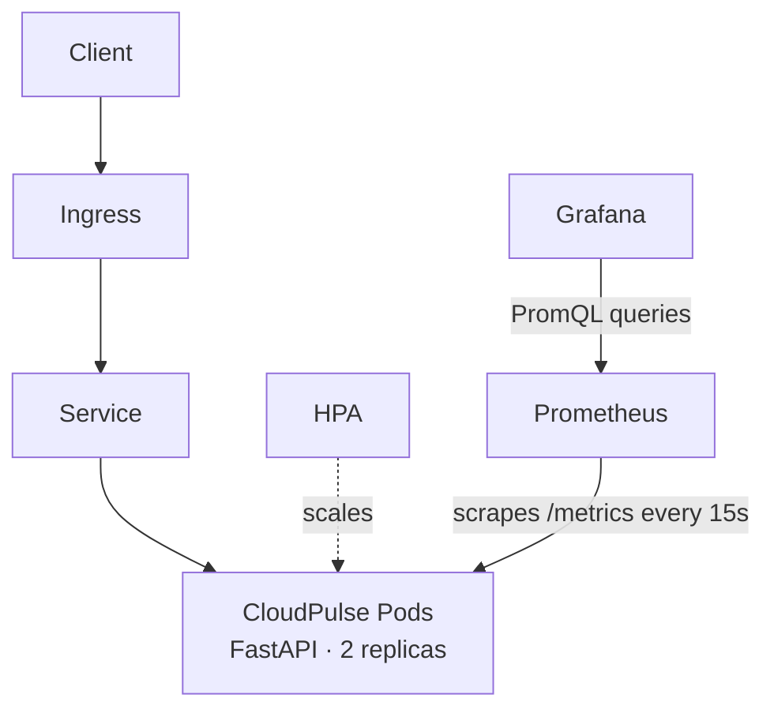

<div align="center">

# 🚀 CloudPulse

**A production-style DevOps project: a FastAPI service that is tested, containerized, shipped through CI/CD, deployed on Kubernetes, and monitored with Prometheus and Grafana.**

[](https://github.com/Tanmay-hue/CloudPulse/actions/workflows/ci.yml)


[Quick Start](#-quick-start) · [Architecture](#-architecture) · [CI/CD](#-cicd-pipeline) · [Kubernetes](#-kubernetes-deployment) · [Monitoring](#-monitoring-and-observability) · [Screenshots](#-screenshots)

</div>

---

## 📖 Overview

CloudPulse takes a small Python REST API through the full lifecycle that real services follow:

**code → test → containerize → publish → deploy → observe**

- **Build:** a REST API written with FastAPI, with health, readiness, and metrics endpoints.
- **Ship:** GitHub Actions runs the Pytest suite, builds the Docker image, and publishes it to Docker Hub.
- **Run:** Kubernetes manifests deploy the app with probes, resource limits, rolling updates, autoscaling, and ingress.
- **Observe:** Prometheus scrapes the `/metrics` endpoint and Grafana turns it into dashboards.

---

## ✨ Features

| Area | What's included |
|---|---|
| **Application** | FastAPI REST API, Pytest unit tests, structured logging, `/health`, `/ready`, and `/metrics` endpoints |
| **Containerization** | Dockerfile for a portable image, `docker-compose.yml` for local runs |
| **CI/CD** | GitHub Actions workflow for install, test, build, and publish to Docker Hub |
| **Kubernetes** | Namespace, Deployment (2 replicas, RollingUpdate), Service, Ingress, ConfigMap, Secret, HPA |
| **Reliability** | Liveness and readiness probes, CPU and memory requests and limits, graceful startup and shutdown |
| **Monitoring** | Prometheus scrape config, Grafana datasource and a ready-to-import dashboard |

---

## 🏗 Architecture

<p align="center">
  
</p>

### Request and monitoring flow



---

## 🧰 Tech Stack

| Category | Technology |
|---|---|
| Language | Python 3.13 |
| Framework | FastAPI |
| Testing | Pytest |
| Containerization | Docker |
| CI/CD | GitHub Actions |
| Registry | Docker Hub |
| Orchestration | Kubernetes |
| Metrics | Prometheus |
| Dashboards | Grafana |
| Version control | Git and GitHub |

---

## 📁 Project Structure

```text
CloudPulse/
├── app/                          # FastAPI application
│   ├── main.py                   # App entry point and routes
│   ├── config.py                 # Configuration
│   ├── logger.py                 # Structured logging
│   ├── metrics.py                # Prometheus metrics
│   ├── models.py                 # Data models
│   ├── database.py               # Data layer
│   └── requirements.txt
├── tests/
│   └── test_api.py               # Pytest test suite
├── k8s/                          # Kubernetes manifests
│   ├── namespace.yaml
│   ├── configmap.yaml
│   ├── secret.yaml
│   ├── deployment.yaml
│   ├── service.yaml
│   ├── ingress.yaml
│   ├── hpa.yaml
│   ├── prometheus-configmap.yaml
│   ├── prometheus-deployment.yaml
│   ├── prometheus-service.yaml
│   ├── grafana-deployment.yaml
│   └── grafana-service.yaml
├── monitoring/
│   ├── prometheus.yml            # Scrape configuration
│   └── grafana/
│       ├── datasource.yml        # Prometheus datasource
│       └── dashboard.json        # Importable dashboard
├── .github/workflows/ci.yml      # CI/CD pipeline
├── Dockerfile
├── docker-compose.yml
├── pytest.ini
└── README.md
```

---

## ⚡ Quick Start

The fastest way to see CloudPulse running (requires Docker):

```bash
git clone https://github.com/Tanmay-hue/CloudPulse.git
cd CloudPulse

docker build -t cloudpulse:latest .
docker run -d --name cloudpulse-container -p 8000:8000 cloudpulse:latest

curl http://localhost:8000/health
```

Then open **http://localhost:8000/docs** for the interactive Swagger UI.

Want to run it without Docker, deploy to Kubernetes, or pull the published image? See the sections below.

---

## 🔌 API Reference

| Method | Endpoint | Description |
|---|---|---|
| `GET` | `/` | Home response |
| `GET` | `/health` | Liveness check |
| `GET` | `/ready` | Readiness check |
| `GET` | `/version` | Application version |
| `GET` | `/users` | List users |
| `POST` | `/users` | Create a user |
| `GET` | `/metrics` | Prometheus metrics |

Interactive documentation is available at `/docs` (Swagger UI) when the app is running.

---

## 💻 Running Locally

**Prerequisites:** Python 3.13, Git, pip

```bash
# 1. Clone
git clone https://github.com/Tanmay-hue/CloudPulse.git
cd CloudPulse

# 2. Create and activate a virtual environment
python3 -m venv .venv
source .venv/bin/activate            # Windows: .venv\Scripts\activate

# 3. Install dependencies
python -m pip install --upgrade pip
pip install -r app/requirements.txt

# 4. Start the app (auto-reload for development)
uvicorn app.main:app --reload
```

The API is now available at `http://127.0.0.1:8000`, with Swagger UI at `http://127.0.0.1:8000/docs`.

**Try the endpoints**

```bash
curl http://127.0.0.1:8000/
curl http://127.0.0.1:8000/health
curl http://127.0.0.1:8000/ready
curl http://127.0.0.1:8000/version
curl http://127.0.0.1:8000/metrics
```

**Run the tests**

```bash
pytest
```

---

## 🐳 Running with Docker

<details>
<summary><b>Build and run the image</b></summary>

```bash
# Build
docker build -t cloudpulse:latest .

# Run in the background, mapping host port 8000 to the container
docker run -d --name cloudpulse-container -p 8000:8000 cloudpulse:latest
```

| Flag | Meaning |
|---|---|
| `-t cloudpulse:latest` | Names and tags the image |
| `-d` | Runs the container in detached mode |
| `--name` | Gives the container a readable name |
| `-p 8000:8000` | Maps host port 8000 to container port 8000 |

</details>

<details>
<summary><b>Inspect, debug, and clean up</b></summary>

```bash
docker ps                                   # running containers
docker logs -f cloudpulse-container         # follow logs
docker stats cloudpulse-container           # live CPU and memory usage

docker stop cloudpulse-container            # stop
docker rm cloudpulse-container              # remove the container
docker rmi cloudpulse:latest                # remove the image
```

Removing a container does not remove its image, so the image can be reused to start a new container.

</details>

<details>
<summary><b>Use the published image from Docker Hub</b></summary>

```bash
docker pull <your-dockerhub-username>/cloudpulse:latest
docker run -d -p 8000:8000 <your-dockerhub-username>/cloudpulse:latest
```

</details>

---

## 🔄 CI/CD Pipeline

<p align="center">
  
</p>

The GitHub Actions workflow (`.github/workflows/ci.yml`) runs on repository changes:


1. **Checkout:** pulls the latest code from GitHub.
2. **Install dependencies:** sets up Python and installs `app/requirements.txt`.
3. **Test:** runs the Pytest suite, so a failing test stops the pipeline before any image is built.
4. **Build:** builds the Docker image from the `Dockerfile`.
5. **Publish:** pushes the image to Docker Hub, ready to be deployed.

Registry credentials are stored as GitHub repository secrets, not in the code.

---

## ☸️ Kubernetes Deployment

<p align="center">
  
</p>

### Resources

| Resource | Purpose |
|---|---|
| **Namespace** | Isolates and organizes all CloudPulse resources |
| **Deployment** | Runs 2 replicas with a RollingUpdate strategy |
| **Service** | Stable internal network endpoint for the Pods |
| **Ingress** | HTTP routing from outside the cluster |
| **ConfigMap** | Non-sensitive application configuration |
| **Secret** | Sensitive configuration values |
| **HPA** | Scales replicas automatically based on resource utilization |

### Reliability and resource management

- **Liveness probe** (`/health`): Kubernetes restarts a container that stops responding.
- **Readiness probe** (`/ready`): traffic is only sent to Pods that are ready to serve it.
- **Requests and limits:** CPU and memory are reserved and capped per container.
- **Rolling updates:** new versions roll out gradually so the app stays available.
- **Graceful shutdown:** in-flight requests can finish before a Pod terminates.

### Deploy

**Prerequisites:** a running cluster (Minikube, kind, or a managed cluster) and `kubectl`.

```bash
# Namespace and configuration
kubectl apply -f k8s/namespace.yaml
kubectl apply -f k8s/configmap.yaml
kubectl apply -f k8s/secret.yaml

# Application
kubectl apply -f k8s/deployment.yaml
kubectl apply -f k8s/service.yaml
kubectl apply -f k8s/ingress.yaml
kubectl apply -f k8s/hpa.yaml
```

Verify:

```bash
kubectl get pods -n cloudpulse
kubectl get svc -n cloudpulse
kubectl get hpa -n cloudpulse
```

> **Note:** the HPA needs [metrics-server](https://github.com/kubernetes-sigs/metrics-server) in the cluster, and the Ingress needs an ingress controller (for example NGINX). On Minikube: `minikube addons enable metrics-server ingress`.

---

## 📊 Monitoring and Observability

CloudPulse exposes metrics at `/metrics`. Prometheus scrapes them every **15 seconds**, and Grafana visualizes them using Prometheus as its data source, giving visibility into availability, HTTP request metrics, CPU utilization, and memory consumption.

### 1. Deploy Prometheus

```bash
kubectl apply -f k8s/prometheus-configmap.yaml
kubectl apply -f k8s/prometheus-deployment.yaml
kubectl apply -f k8s/prometheus-service.yaml

kubectl port-forward svc/prometheus-service 9090:9090 -n cloudpulse
```

Open `http://localhost:9090` and check **Status → Targets**. The CloudPulse target should show `UP`.

### 2. Deploy Grafana

```bash
kubectl apply -f k8s/grafana-deployment.yaml
kubectl apply -f k8s/grafana-service.yaml

kubectl port-forward svc/grafana-service 3000:3000 -n cloudpulse
```

Open `http://localhost:3000`.

### 3. Connect Grafana to Prometheus

1. Go to **Connections → Data sources → Add data source → Prometheus**.
2. Set the URL to `http://prometheus-service:9090`.
3. Click **Save & test**.
4. Import `monitoring/grafana/dashboard.json` via **Dashboards → New → Import**, or build your own panels with PromQL.

---

## 🖼 Screenshots

### Swagger UI
Interactive API documentation for exploring and testing endpoints.


### GitHub Actions: successful CI/CD run
Tests, image build, and Docker Hub publish all passing.


### Docker Hub repository
The image published by the pipeline.


### Prometheus targets and metrics
Prometheus successfully scraping the application.


### Grafana dashboard
Request and resource metrics visualized from Prometheus data.


---

## 🛠 Troubleshooting

| Problem | Things to check |
|---|---|
| Pods stuck in `Pending` or `CrashLoopBackOff` | `kubectl describe pod <name> -n cloudpulse` and `kubectl logs <name> -n cloudpulse` |
| Pod running but not `Ready` | Confirm `/ready` responds correctly and the probe path and port match the container |
| HPA shows `<unknown>` for CPU | metrics-server is missing, or the Deployment has no CPU requests set |
| Prometheus target is `DOWN` | Verify the scrape target in the Prometheus ConfigMap matches the Service name and port |
| Grafana shows "No data" | Confirm the datasource URL is `http://prometheus-service:9090` and the target is `UP` |
| Port 8000 already in use | Stop the other process, or map a different host port, e.g. `-p 8080:8000` |

---

## 🗺 Roadmap

- [x] FastAPI service with tests, health checks, and metrics
- [x] Dockerized app with automated CI/CD to Docker Hub
- [x] Kubernetes deployment with probes, limits, HPA, and ingress
- [x] Prometheus and Grafana monitoring
- [ ] Deploy to **AWS EKS** (managed Kubernetes)
- [ ] Provision infrastructure with **Terraform**
- [ ] Automate deployment to the cluster from the CI/CD pipeline
- [ ] Add alerting rules (Prometheus Alertmanager)

---

## 💡 What I Learned

- Wiring a full path from commit to running Pod, and where each stage can fail.
- Why liveness and readiness probes are separate, and how they affect rollouts.
- Setting resource requests and limits so autoscaling behaves predictably.
- Exposing application metrics and turning them into useful dashboards.

---

## 👤 Author

**Sandeep kulkarni**

[GitHub](https://github.com/Sandeepkulkarni77) · [LinkedIn](https://www.linkedin.com/in/sandeep-kulkarni-b8a69a29a/)

If you found this project useful, consider giving it a ⭐.
